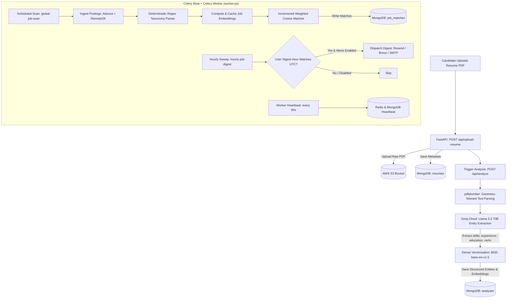

# TalentMap — AI-Powered Resume-to-Job Matching & Career Telemetry Platform

[](https://www.python.org/)
[](https://fastapi.tiangolo.com/)
[](https://docs.celeryq.dev/)
[](https://redis.io/)
[](https://www.mongodb.com/atlas)
[](https://groq.com/)
[](https://huggingface.co/BAAI/bge-base-en-v1.5)
[](https://aws.amazon.com/s3/)

**TalentMap** is an enterprise-grade, distributed career intelligence platform that continuously analyzes candidates' resumes and autonomously matches them against live postings across active labor markets. 

Instead of requiring users to manually search and filter job boards every day, TalentMap acts as an autonomous background agent. It extracts structured entities from resume PDFs using **Groq-hosted Llama 3.3 70B**, encodes profile dimensions into dense **768-dimensional BGE vector embeddings**, ingests real job postings from **Adzuna** and **RemoteOK**, performs multi-component weighted semantic matching, and dispatches proactive email digests (via **Resend**, **Brevo**, and **SMTP** fallback).

---

## Architecture Overview

TalentMap is designed as **two decoupled, independently scalable processes** communicating through **MongoDB Atlas** (shared persistent data) and **Redis** (task broker, result backend, and distributed heartbeats):

```
┌─────────────────────────────────────────────────────────┐
│                   Client Browser                        │
│        (Jinja2 Server-Rendered Shell + Vanilla JS)      │
└────────────────────────────┬────────────────────────────┘
                             │ REST API + JWT
                             ▼
┌─────────────────────────────────────────────────────────┐
│               Process 1: Web API (FastAPI)              │
│                      app/main.py                        │
├─────────────────────────────────────────────────────────┤
│ • Auth & Google OAuth 2.0 (Atomic Claim-and-Burn)       │
│ • Resume Ingestion & AWS S3 Presigned URLs              │
│ • NLP Pipeline (pdfplumber + Groq LLM + BGE Embeddings) │
│ • Dashboard, Matches, Activity & Market Trends APIs     │
└───────────────┬─────────────────────────┬───────────────┘
                │                         │
      MongoDB   │                         │ Redis
      Atlas     │                         │ Broker / Heartbeat
                ▼                         ▼
┌─────────────────────────────────────────────────────────┐
│         Process 2: Background Worker & Scheduler        │
│                (Celery + Celery Beat)                   │
│                      worker.py                          │
├─────────────────────────────────────────────────────────┤
│ • Celery Beat Periodic Scheduler (Cron & Intervals)     │
│ • Job Fetchers (Adzuna API + RemoteOK API)              │
│ • Deterministic Taxonomy Extractor (config/*.json regex)│
│ • Incremental Resume-to-Job Semantic Matcher            │
│ • Multi-Provider Email Digest Engine (Resend/Brevo/SMTP)│
│ • Real-Time Worker Heartbeat Telemetry                  │
└─────────────────────────────────────────────────────────┘
```

### Architectural Engineering Decisions

1. **Process Decoupling**: The scheduler runs in a dedicated worker process (`worker.py`) rather than inside FastAPI's event loop. Heavy sentence-transformer embedding calculations, external API scraping, and batch matching scans never block incoming HTTP requests or UI rendering.
2. **Resilience & Fault Isolation**: Web API reloads, deployments, or transient HTTP failures do not disrupt in-flight job scans. Conversely, if background workers experience rate-limiting or failures, users can seamlessly log in, inspect their historical analyses, and browse cached matches.
3. **Independent Horizontal Scaling**: The Web API is completely stateless and can scale horizontally across multiple instances behind a load balancer. Worker processes scale independently based on Redis task queue volume.
4. **Live Heartbeat Monitoring**: Background workers continuously emit heartbeats to Redis (`talentmap:worker:heartbeat`, 300s TTL) and MongoDB (`scheduler_locks`). The dashboard reads these signals to present real-time worker health (`healthy` < 4m, `stale` < 10m, `down` > 10m).

---

## How It Works: The End-to-End Pipeline



### 1. Resilient PDF Layout Parsing (`app/step2_nlp/pdf_parser_1.py`)
Resumes frequently use complex multi-column layouts, sidebars, and tabular skill lists that break naive text extractors. TalentMap uses `pdfplumber` with custom geometric tolerance tuning:
```python
text = page.extract_text(x_tolerance=1, y_tolerance=3)
```
- `x_tolerance=1`: Prevents text in adjacent columns from merging together.
- `y_tolerance=3`: Preserves subscripts, superscripts, and lines without premature fragmentation.

### 2. LLM-Based Entity Extraction (`app/step2_nlp/ner_extraction_3.py`)
- **Model**: `llama-3.3-70b-versatile` via **Groq REST API** (`temperature=0` for deterministic outputs).
- **Target Schema**: Extracts 5 discrete entities: `skills`, `education`, `experience`, `projects`, and `certifications`.
- **Defensive Parsing**: Includes `_flatten_entities()` to intercept and normalize nested structures into validated string lists, ensuring Pydantic compliance.

### 3. Dense Vector Embeddings (`app/step2_nlp/embeddings_4.py`)
- **Embedding Model**: `BAAI/bge-base-en-v1.5` (Sentence-Transformers), generating 768-dimensional dense vectors.
- **Asymmetric Search Encoding**: Applies BGE's asymmetric search query prefix (`"Represent this sentence for searching relevant passages: "`) when indexing job descriptions.
- **Normalized Dot Product**: Embeddings are computed with `normalize_embeddings=True`. Cosine similarity is computed in $\mathcal{O}(d)$ time via dot products:
  $$\text{Cosine Similarity} = \frac{\mathbf{u} \cdot \mathbf{v}}{\|\mathbf{u}\| \|\mathbf{v}\|} = \mathbf{u} \cdot \mathbf{v}$$

### 4. Autonomous Job Sourcing (`app/step4_agent/job_source_fetcher.py`)
- **Adzuna API**: Sourced for regional, verified employer listings. Search terms are dynamically derived from active users' parsed resume job titles (`analysis_collection.distinct("entities.experience")`), ensuring quota is spent exclusively on relevant roles.
- **RemoteOK API**: Public API providing global remote tech postings, requested with custom User-Agent headers to ensure reliable throughput.
- **Ingestion Deduplication**: MongoDB compound unique index `[("source", 1), ("external_id", 1)]` guarantees postings are never duplicated.

### 5. Deterministic Taxonomy Parsing (<5ms) (`app/step4_agent/job_entity_extractor.py`)
To avoid prohibitive LLM costs and latency when ingesting hundreds of job descriptions, job postings are parsed using externalized taxonomy dictionaries (`config/skills.json`, `config/certifications.json`, etc.) with pre-compiled regex word boundaries (`(?<!\w)term(?!\w)`).

### 6. Honest Multi-Component Weighted Matching (`app/step4_agent/matcher.py`)
Rather than scoring raw monolithic text, TalentMap scores discrete semantic dimensions:

| Dimension | Weight | Focus |
|---|:---:|---|
| **Skills** | **40%** | Technical competencies, tools, programming languages, and cloud platforms |
| **Experience** | **30%** | Roles, job titles, responsibilities, and seniority |
| **Education** | **15%** | Academic degrees, disciplines, and institutions |
| **Certifications** | **15%** | Industry certifications (AWS, GCP, CKA, PMP, etc.) |

> **Honest Missing-Data Algorithm**: In traditional scoring, missing certifications on either side would be scored 0%, penalizing a candidate by 15%. TalentMap excludes absent components from both numerator and denominator, scoring only across comparable dimensions.

### 7. Dual Performance Optimizations
1. **Cached Job Embeddings**: Computing sentence-transformer embeddings takes ~500ms per job description. TalentMap computes embeddings **once** upon ingestion and caches them on the MongoDB `job_postings` document. Subsequent scans require zero transformer inference.
2. **Incremental Scans**: Worker scans only compare against jobs ingested since `last_scan_at`, minimizing compute during recurring cycles.

### 8. Multi-Provider Notification Dispatcher (`app/step4_agent/email_alerts.py`)
Automated email alerts operate via a multi-tiered fallback chain:
$$\text{Resend API} \longrightarrow \text{Brevo (Sendinblue) API} \longrightarrow \text{SMTP Relay}$$
User preferences support four frequencies:
- `immediate`: Alerts sent as soon as a scan discovers a qualifying match.
- `daily`: Sent at the user's configured UTC hour (`digest_hour`).
- `weekly`: Aggregates the week's best matches every 7 days.
- `never`: Silently silences email delivery.

---

## Directory Structure

```
TalentMap/
├── app/
│   ├── main.py                    # FastAPI entrypoint, router registration, static mount
│   ├── config.py                  # Pydantic BaseSettings — centralized env configuration
│   │
│   ├── core/                      # Shared infrastructure modules
│   │   ├── db.py                  # MongoDB Atlas connection, indexes, and collection handles
│   │   ├── celery_app.py          # Celery app instance, Redis broker, and Beat schedule
│   │   ├── logger.py              # Centralized logging configuration
│   │   ├── s3_utils.py            # AWS S3 client, uploads, and presigned URL generation
│   │   ├── security.py            # Password hashing (bcrypt) and JWT encode/decode
│   │   └── templates.py           # Jinja2 template rendering helper
│   │
│   ├── routers/                   # HTTP endpoints & presentation controllers
│   │   ├── registration.py        # POST /register
│   │   ├── login.py               # POST /login, POST /logout
│   │   ├── oauth_google.py        # Google OAuth 2.0 (Claim-and-Burn handoff protocol)
│   │   ├── pages.py               # Jinja2 template routes (/dashboard, /matches, /resume, etc.)
│   │   ├── dashboard_api.py       # GET /api/dashboard telemetry aggregation
│   │   ├── market_trends_api.py   # GET /api/market-trends skill gap & salary insights
│   │   ├── activity_api.py        # GET /api/activity audit log
│   │   └── settings_api.py        # GET /api/settings, PUT /api/settings
│   │
│   ├── step1_api/                 # Resume ingestion & history routes
│   │   ├── upload_resume_1.py     # POST /api/upload-resume (S3 + Mongo)
│   │   ├── resume_analyze_2.py    # POST /api/analyze (NLP pipeline orchestration)
│   │   └── routes_history.py      # GET /api/resumes, download presigned URLs, activate/delete
│   │
│   ├── step2_nlp/                 # Natural Language Processing & Vectorization
│   │   ├── pdf_parser_1.py        # Geometry-aware text extraction (pdfplumber)
│   │   ├── preprocess_2.py        # Case-preserving text cleaner & spaCy lemmatizer
│   │   ├── ner_extraction_3.py    # Groq Cloud LLM entity extractor (Llama 3.3 70B)
│   │   └── embeddings_4.py        # BGE dense vector embeddings (BAAI/bge-base-en-v1.5)
│   │
│   ├── step4_agent/               # Autonomous agent matching & alert engine
│   │   ├── job_source_fetcher.py  # Ingestion connectors for Adzuna & RemoteOK
│   │   ├── job_entity_extractor.py# Deterministic regex taxonomy extraction (<5ms/job)
│   │   ├── matcher.py             # Weighted multi-component cosine similarity engine
│   │   ├── email_alerts.py        # Resend → Brevo → SMTP fallback email dispatcher
│   │   ├── scheduler.py           # Scan cycles, daily digests, and heartbeat trackers
│   │   ├── state.py               # Per-user and global agent state management
│   │   └── routes_agent.py        # GET /api/agent/status, GET /api/jobs/matches, apply/save
│   │
│   ├── services/                  # Business logic services
│   │   ├── market_trends_data.py  # Live labor market skill supply/demand analytics
│   │   ├── market_insights.py     # Contextual advice generation
│   │   ├── settings_data.py       # Notification & threshold preferences
│   │   ├── activity_log.py        # Append-only activity audit trail
│   │   └── s3_service.py          # S3 presigned download service
│   │
│   ├── schemas/                   # Pydantic request & response models
│   ├── tasks/                     # Celery background tasks
│   │   ├── scheduled_tasks.py     # Celery Beat tasks (scan, digest sweep, heartbeat)
│   │   └── test_tasks.py          # Celery test tasks
│   └── database/                  # Legacy database helper
│
├── worker.py                      # Celery worker CLI runner (starts worker + beat scheduler)
├── templates/                     # Jinja2 HTML page shells (client-hydrated)
├── static/                        # Vanilla CSS styling, icons, and client JS controllers
├── config/                        # Standardized taxonomy dictionaries (*.json)
│   ├── skills.json
│   ├── certifications.json
│   ├── education.json
│   └── experience.json
├── scripts/
│   └── seed_data.py               # Database bootstrapping & mock data script
├── tests/                         # Test suite scaffolding (API, embeddings, PDF parser)
├── requirements.txt               # Pinned Python package dependencies
├── .env.example                   # Complete environment configuration template
├── Dockerfile                     # Multi-stage production container configuration
└── docker-compose.yml             # Local service orchestration (MongoDB, Redis, Web, Worker)
```

---

## Technology Stack

| Layer | Technology | Specification / Version | Purpose / Rationale |
|---|---|---|---|
| **Web Framework** | FastAPI | `0.111.0` | High-performance asynchronous REST API, Pydantic validation, and dependency injection |
| **UI Templating** | Jinja2 + Vanilla JS | `3.1.4` | Server-rendered shells with client-side JSON API hydration (`localStorage` JWT) |
| **Task Queue & Scheduler** | Celery + Redis | `5.4.0` / `5.0.0` | Distributed asynchronous task execution with Celery Beat periodic job scheduling |
| **Primary Database** | MongoDB Atlas | `4.7.3` (`pymongo`) | Flexible document store with compound unique indexes and automatic TTL garbage collection |
| **Object Storage** | AWS S3 | `1.43.31` (`boto3`) | Encrypted storage for candidate resume PDFs with time-expiring presigned download URLs |
| **LLM Entity Extraction** | Groq Cloud | Llama 3.3 70B Versatile | Deterministic (`temperature=0`) sub-second structured JSON entity extraction |
| **Vector Embeddings** | Sentence-Transformers | `BAAI/bge-base-en-v1.5` | 768-dimensional dense vectors with asymmetric query prefixes and unit normalization |
| **PDF Parsing** | `pdfplumber` | `0.10.3` | Geometry-aware extraction preserving complex column, table, and sidebar layouts |
| **Authentication** | `python-jose` + `passlib` | JWT (HS256) + Bcrypt | Stateless Bearer token sessions and salted password hashes |
| **OAuth 2.0** | Google OAuth 2.0 | Claim-and-Burn | Single-use atomic handoff token protocol preventing token exposure in browser history |
| **Job Market APIs** | Adzuna + RemoteOK | REST APIs | Live job ingestion combining quota-managed regional roles and remote developer listings |
| **Email Dispatch** | Resend / Brevo / SMTP | Fallback Chain | Multi-provider fallback delivery for immediate alerts and scheduled HTML digests |

---

## Celery Worker & Scheduled Tasks

The background worker (`worker.py`) executes **Celery Beat** with three periodic tasks configured in `app/core/celery_app.py`:

```
┌────────────────────────────────────────────────────────────────┐
│                          Celery Beat                           │
└────────────┬───────────────────┬───────────────────┬───────────┘
             │ (every 6 hrs)     │ (hourly at :00)   │ (every 60s)
             ▼                   ▼                   ▼
    ┌─────────────────┐ ┌─────────────────┐ ┌─────────────────┐
    │ Global Job Scan │ │  Hourly Digest  │ │Worker Heartbeat │
    │ & Match Engine  │ │  Email Dispatch │ │   Monitoring    │
    └─────────────────┘ └─────────────────┘ └─────────────────┘
```

1. **`global-job-scan`** (`app.tasks.scheduled_tasks.run_global_scan_task`):
   - **Schedule**: Every `AGENT_SCAN_INTERVAL_MINUTES` (defaults to 360 minutes / 6 hours).
   - **Operation**: Ingests new postings from Adzuna and RemoteOK, extracts entities deterministically, caches dense BGE embeddings, and matches newly discovered jobs against all active user resumes.
2. **`hourly-job-digest`** (`app.tasks.scheduled_tasks.daily_job_digest`):
   - **Schedule**: Hourly on the hour (`crontab(minute=0)`).
   - **Operation**: Sweeps active users. If `current_hour_utc == user.digest_hour` and email alerts are enabled, compiles top qualifying matches into an HTML digest and delivers via Resend/Brevo/SMTP.
3. **`worker-heartbeat`** (`app.tasks.scheduled_tasks.worker_heartbeat_task`):
   - **Schedule**: Every 60 seconds.
   - **Operation**: Refreshes worker liveness timestamps in Redis (`talentmap:worker:heartbeat`, 300s TTL) and MongoDB (`scheduler_locks`).

---

## Security & Authentication

- **Stateless JWT Authorization**: Requests authenticate using HTTP header `Authorization: Bearer <token>`, verified via FastAPI dependency `Depends(get_current_user)`.
- **Bcrypt Password Encryption**: Passwords hashed with automatic individual salting via `passlib[bcrypt]`.
- **Google OAuth 2.0 Atomic Claim-and-Burn**:
  To prevent leaking JWT credentials via URL redirects or browser history, Google OAuth employs an atomic handoff pattern:
  1. Callback validates Google credentials and issues an ephemeral, cryptographically random handoff token (`secrets.token_urlsafe(32)`).
  2. The token is stored in MongoDB with a 300-second TTL index.
  3. The browser redirects to `/auth/google/complete?handoff=<token>`.
  4. Client-side JS executes `POST /api/auth/google/finalize`. The backend calls `oauth_handoff_collection.find_one_and_delete({"_id": handoff})`, destroying the token atomically upon retrieval and returning the JWT session. Replay attacks are structurally impossible.
- **S3 Presigned URLs**: Resume files stored in private S3 buckets are never served publicly. Download links are generated on-demand with 15-minute expirations.

---

## API Reference

### Authentication & Pages
| Method | Endpoint | Description |
|---|---|---|
| `POST` | `/register` | Register a new user account |
| `POST` | `/login` | Authenticate with email/password and obtain JWT |
| `GET` | `/api/auth/google/login` | Initiate Google OAuth 2.0 redirect |
| `GET` | `/api/auth/google/callback` | Google OAuth redirect callback (issues handoff token) |
| `POST` | `/api/auth/google/finalize` | Atomic claim-and-burn exchange of handoff token for JWT |
| `GET` | `/dashboard`, `/matches`, `/resume`, `/market-trends`, `/settings` | Jinja2 page shells |

### Resumes & NLP Analysis
| Method | Endpoint | Description |
|---|---|---|
| `POST` | `/api/upload-resume` | Upload PDF to S3 and save metadata record |
| `POST` | `/api/analyze` | Parse PDF with `pdfplumber`, extract entities via Groq, generate BGE embeddings |
| `GET` | `/api/resumes` | List user resumes with active flag and S3 keys |
| `GET` | `/api/resumes/{resume_id}/download` | Generate secure AWS S3 presigned download URL |
| `POST` | `/api/resumes/{resume_id}/activate` | Set active resume for matching |
| `DELETE`| `/api/resumes/{resume_id}` | Delete resume record and associated analyses |
| `GET` | `/api/history/{user_id}` | Retrieve historical analyses and extracted profiles |

### Job Matches & AI Agent
| Method | Endpoint | Description |
|---|---|---|
| `GET` | `/api/agent/status` | Real-time agent status, countdown to next scan, worker health, and match distribution |
| `GET` | `/api/jobs/matches` | Filterable list of semantic job matches for current user |
| `GET` | `/api/jobs/matches/{job_id}` | Detailed match inspection (skills matched, skill gaps, similar jobs) |
| `PATCH`| `/api/jobs/matches/{job_id}/apply` | Update application status (`applied: true/false`) |
| `PATCH`| `/api/jobs/matches/{job_id}/save` | Bookmark or unbookmark a job match |

### Telemetry & Settings
| Method | Endpoint | Description |
|---|---|---|
| `GET` | `/api/dashboard` | Aggregated dashboard stats (active resume, match counts, worker status) |
| `GET` | `/api/market-trends` | Real-time labor market trends, high-demand skills, and salary bands |
| `GET` | `/api/activity` | User activity audit feed |
| `GET` | `/api/settings` | Get user notification and matching preferences |
| `PUT` | `/api/settings` | Update alert frequency, match threshold, and digest hour |

---

## Getting Started

### Prerequisites

1. **Python**: Version 3.10 or higher.
2. **Redis**: Running locally or hosted (e.g. Redis Cloud, Upstash, or local Docker).
3. **MongoDB Atlas**: Free or paid cluster connection URI.
4. **AWS S3**: Bucket with IAM credentials (`s3:PutObject`, `s3:GetObject`, `s3:DeleteObject`).
5. **Groq API Key**: Free API key from [Groq Console](https://console.groq.com/) for Llama 3.3 70B inference.
6. *(Optional)* **Adzuna API Credentials**: For querying Adzuna job listings.
7. *(Optional)* **Google OAuth Credentials**: For "Continue with Google" authentication.
8. *(Optional)* **Resend / Brevo API Key**: For email notifications.

### 1. Clone & Set Up Virtual Environment

```bash
git clone https://github.com/your-username/TalentMap.git
cd TalentMap

# Create virtual environment
python -m venv venv

# Activate virtual environment
# On Linux/macOS:
source venv/bin/activate
# On Windows (PowerShell):
.\venv\Scripts\Activate.ps1
```

### 2. Install Dependencies

```bash
pip install --upgrade pip
pip install -r requirements.txt

# Download spaCy lightweight English model
python -m spacy download en_core_web_sm
```

### 3. Configure Environment Variables

Copy `.env.example` to `.env` and fill in your credentials:

```bash
cp .env.example .env
```

At minimum, ensure the following variables are defined in `.env`:

```env
# MongoDB Atlas connection string
MONGODB_URI=mongodb+srv://<user>:<password>@<cluster>.mongodb.net/?appName=TalentMap

# Redis connection string (required for Celery worker and heartbeats)
REDIS_URL=redis://localhost:6379/0

# Secret key for JWT signing (generate via python -c "import secrets; print(secrets.token_hex(32))")
SECRET_KEY=your-32-byte-hex-secret-key

# AWS S3 bucket configuration
AWS_ACCESS_KEY_ID=your-aws-access-key
AWS_SECRET_ACCESS_KEY=your-aws-secret-key
AWS_BUCKET_NAME=your-talentmap-bucket
AWS_REGION=us-east-1

# Groq API for resume entity extraction
GROQ_API_KEY=gsk_your_groq_api_key

# Background Agent Master Switch
AGENT_SCHEDULER_ENABLED=True
AGENT_SCAN_INTERVAL_MINUTES=360
```

### 4. Start Redis

Ensure your Redis server is active:
```bash
# If using local Redis:
redis-server

# Or with Docker:
docker run -d --name talentmap-redis -p 6379:6379 redis:alpine
```

### 5. Run the Application

The system requires two concurrent processes:

#### Terminal 1 — FastAPI Web Application:
```bash
uvicorn app.main:app --reload --host 0.0.0.0 --port 8000
```
*Access the web UI at `http://localhost:8000` (auto-redirects to `/login`).*

#### Terminal 2 — Background Celery Worker & Beat Scheduler:
```bash
python worker.py
```
*Or invoke directly via Celery CLI:*
```bash
# On Linux / macOS:
celery -A app.core.celery_app worker --beat --loglevel=info

# On Windows (requires solo pool):
celery -A app.core.celery_app worker --beat --loglevel=info -P solo
```

---

## Production Deployment

In production, run the Web API and Background Worker as separate supervised services:

### Example: Systemd (Linux VPS)

**/etc/systemd/system/talentmap-web.service**:
```ini
[Unit]
Description=TalentMap FastAPI Web Service
After=network.target

[Service]
User=ubuntu
WorkingDirectory=/var/www/TalentMap
EnvironmentFile=/var/www/TalentMap/.env
ExecStart=/var/www/TalentMap/venv/bin/uvicorn app.main:app --host 0.0.0.0 --port 8000 --workers 4
Restart=always

[Install]
WantedBy=multi-user.target
```

**/etc/systemd/system/talentmap-worker.service**:
```ini
[Unit]
Description=TalentMap Celery Worker and Beat
After=network.target redis.service

[Service]
User=ubuntu
WorkingDirectory=/var/www/TalentMap
EnvironmentFile=/var/www/TalentMap/.env
ExecStart=/var/www/TalentMap/venv/bin/celery -A app.core.celery_app worker --beat --loglevel=info
Restart=always

[Install]
WantedBy=multi-user.target
```

### Example: Procfile (Render / Railway / Heroku)
```ini
web: uvicorn app.main:app --host 0.0.0.0 --port $PORT
worker: celery -A app.core.celery_app worker --beat --loglevel=info
```

---

## Known Limitations & Roadmap

- **Test Suite Scaffolding**: Test signatures and assertions in `tests/test_api.py`, `tests/test_embeddings.py`, and `tests/test_pdf_parser.py` are structural outlines designed for PyTest integration. Full unit and integration assertions are in progress.
- **OCR Fallback**: `pdfplumber` relies on selectable text streams. Image-only or scanned PDFs currently yield empty extracted text; integration with Tesseract OCR is planned for scanned documents.
- **Horizontal Worker Batching**: While Celery enables horizontal worker expansion across multiple nodes, user match sweeps currently iterate sequentially through active profiles per scan cycle. Chunked batch distribution is scheduled for high-volume enterprise deployments.
- **Container Orchestration**: Declarative `Dockerfile` and `docker-compose.yml` templates are provided in the repository for containerized workflows.
